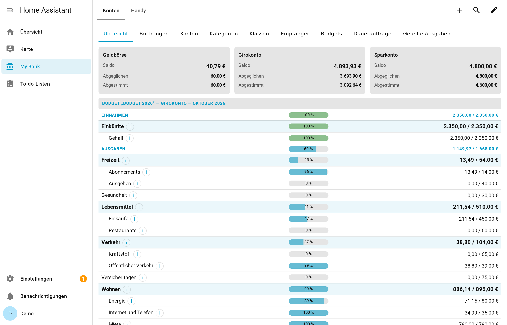
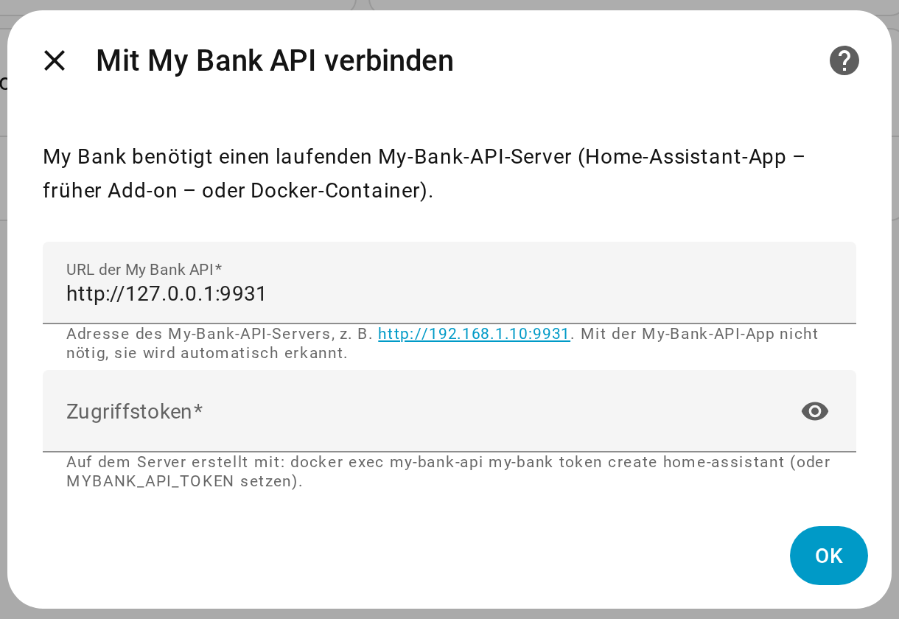
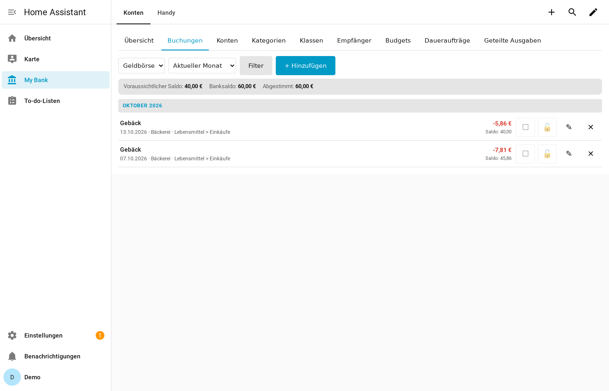
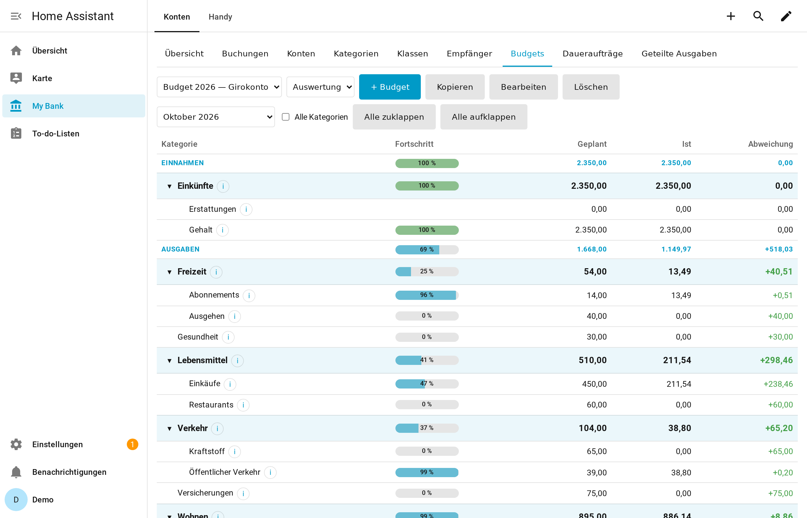
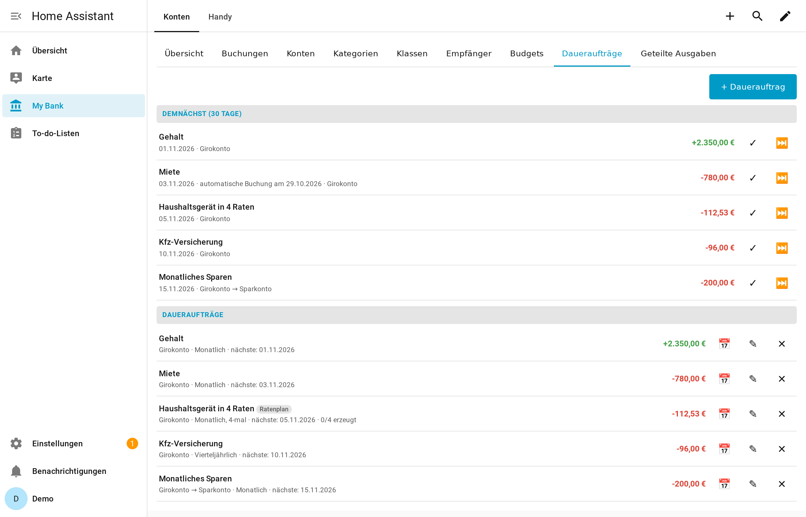
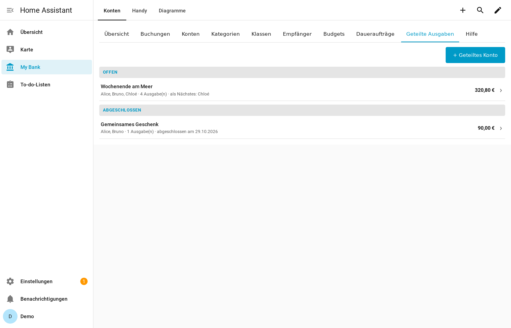
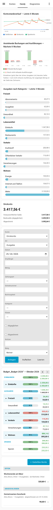
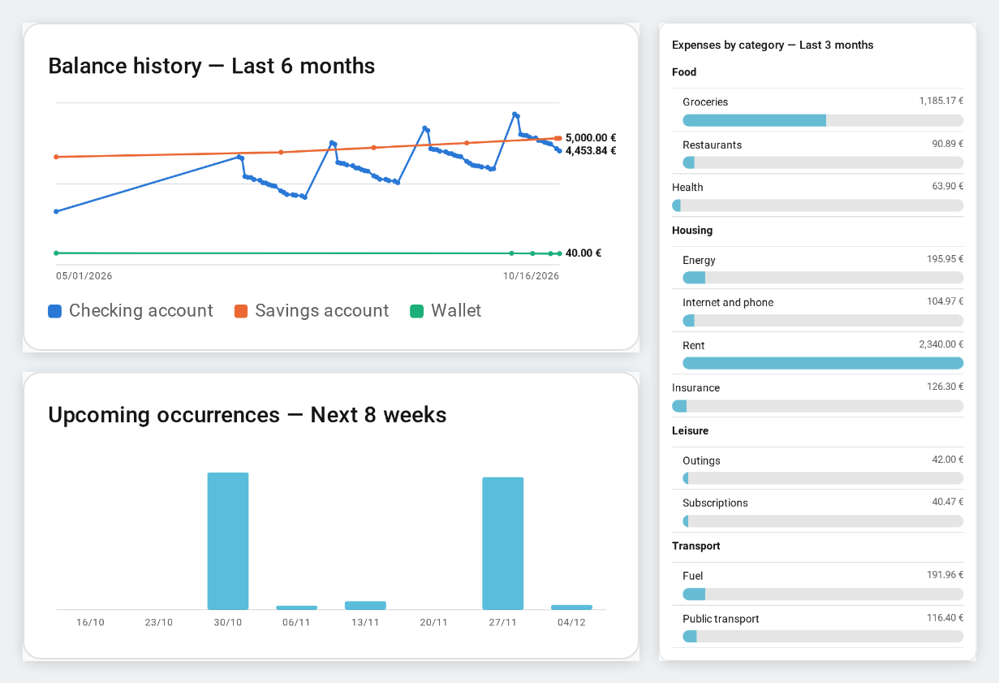

# My Bank für Home Assistant

🇬🇧 [Read in English](https://github.com/Patafoin/ha-my-bank/blob/main/README.md) · 🇫🇷 [Lire en français](https://github.com/Patafoin/ha-my-bank/blob/main/README.fr.md)

[](https://hacs.xyz/)
[](https://github.com/Patafoin/ha-my-bank/actions/workflows/validate.yml)
[](https://github.com/Patafoin/ha-my-bank/actions/workflows/tests.yml)

Persönliche Finanzverwaltung in Home Assistant, so wie Haushaltsbuch-Programme am Computer: Konten mit drei Kontoständen, abgeglichene und abgestimmte Buchungen, Aufteilungen, Umbuchungen, hierarchische Kategorien, Daueraufträge, Budgets und geteilte Ausgaben unter Freunden — über eine Dashboard-Karte, auf dem Handy, überall.



💬 Fragen, Rückmeldungen, Ideen: [Diskussion im Home Assistant Community-Forum](https://community.home-assistant.io/t/my-bank-personal-bookkeeping-in-home-assistant-accounts-budgets-charts-scheduled-shared-expenses-100-local/1029114) (auf Englisch).

> Verfügbar auf **Englisch, Französisch und Deutsch** (Karten, Dienste, Einrichtung, Servermeldungen), je nach Sprache von Home Assistant.

## Funktionsweise

My Bank besteht aus zwei Teilen:

| Teil | Was es ist | Installation |
|---|---|---|
| **My Bank API** | Der Server: speichert Ihre Daten in einer lokalen SQLite-Datenbank, berechnet Kontostände und Budgets, erzeugt die Daueraufträge, sichert sich jede Nacht selbst | Home Assistant **App** (früher *Add-on*; Home Assistant OS / Supervised) oder **Docker**-Container |
| **My Bank** (dieses Repository) | Die Integration und ihre Lovelace-Karten: Sensoren, Dienste und Benutzeroberfläche | **HACS** |

Die Integration ist ein schlanker Client: Alle Regeln (Kontostände, Sperre abgestimmter Buchungen, Budgetberechnungen…) liegen im Server. Ihre Daten verlassen nie Ihr Netzwerk.

## Voraussetzungen

- Home Assistant **2026.2 oder neuer** und [HACS](https://hacs.xyz/) zur Installation der Integration. Getestet mit 2026.2.3 und 2026.10.0.
- Für den Server, wahlweise:
  - **Home Assistant OS** oder eine **Supervised**-Installation auf einem 64-Bit-System (amd64 oder aarch64, z. B. Raspberry Pi 4/5 mit dem 64-Bit-Image), um die App zu nutzen — getestet mit Home Assistant OS 18.3;
  - oder **Docker** auf einem beliebigen 64-Bit-Rechner in Ihrem Netzwerk (amd64 oder arm64), für Installationen von Home Assistant Container / Core.

## Installation

### 1. Der Server

**Home Assistant OS / Supervised — App (empfohlen)**

[](https://my.home-assistant.io/redirect/supervisor_add_addon_repository/?repository_url=https%3A%2F%2Fgithub.com%2FPatafoin%2Fha-addons)

Oder von Hand: Einstellungen → **Apps** → **App installieren** → ⋮ → **Repositories**, `https://github.com/Patafoin/ha-addons` hinzufügen. Danach **My Bank API** installieren und starten. Das ist alles: Die App erstellt ein Zugriffstoken für Home Assistant und meldet sich von selbst.

> Home Assistant-Versionen vor der Umbenennung nennen Apps **Add-ons** (Einstellungen → Add-ons → Add-on Store).

**Home Assistant Container / Core — Docker**

Erzeugen Sie zuerst das Zugriffstoken, eine lange Zufallszeichenkette, mit der Home Assistant mit dem Server spricht:

```bash
openssl rand -hex 32
# oder: python3 -c "import secrets; print(secrets.token_urlsafe(32))"
```

Tragen Sie es unten in `MYBANK_API_TOKEN` ein und bewahren Sie es auf: Sie geben es in Schritt 3 in Home Assistant ein.

```yaml
# compose.yaml
services:
  my-bank-api:
    image: ghcr.io/patafoin/my-bank-api:latest
    container_name: my-bank-api
    restart: unless-stopped
    ports:
      - "9931:8000"
    volumes:
      - ./data:/data
      - ./backups:/backups
    environment:
      TZ: Europe/Berlin
      MYBANK_API_TOKEN: "hier-das-erzeugte-token-einfuegen"
```

```bash
docker compose up -d
curl http://localhost:9931/api/v1/health   # der Server antwortet
```

Das Token wird gehasht in der Datenbank gespeichert. Ändern Sie die Variable und starten Sie neu, um es zu ersetzen; entfernen Sie sie, um es zu widerrufen. Wenn Sie das Token nicht in `compose.yaml` aufbewahren möchten, lassen Sie `MYBANK_API_TOKEN` weg und erstellen Sie stattdessen eines im Container: `docker exec my-bank-api my-bank token create ha` (wird nur einmal angezeigt).

Alle Einstellungen stehen im [README von My Bank API](https://github.com/Patafoin/my-bank-api) (auf Englisch).

### 2. Die Integration

[](https://my.home-assistant.io/redirect/hacs_repository/?owner=Patafoin&repository=ha-my-bank&category=integration)

In HACS: ⋮ → **Benutzerdefinierte Repositories** → `https://github.com/Patafoin/ha-my-bank`, Typ **Integration**. **My Bank** herunterladen und Home Assistant neu starten.

### 3. Verbinden

- **Mit der App**: Einstellungen → Geräte & Dienste zeigt **My Bank** als entdeckt an. Auf **Konfigurieren** klicken und bestätigen.
- **Mit Docker**: Einstellungen → Geräte & Dienste → **Integration hinzufügen** → **My Bank**, dann die Server-URL (z. B. `http://192.168.1.10:9931`) und das in Schritt 1 erzeugte Token eingeben.



### 4. Die Karte hinzufügen

Die Karte wird automatisch registriert (keine Ressource hinzuzufügen). Ein Dashboard bearbeiten → **Karte hinzufügen** → **My Bank**.

Wenn die Karten nach einer Installation oder einem Update nicht in der Auswahl erscheinen, laden Sie die Seite ohne Cache neu (Strg+F5) oder leeren Sie den Cache der Companion-App. Die benutzerdefinierten Karten stehen unten in der Auswahl, oder suchen Sie nach „bank“.

## Die Karten

### `custom:my-bank-card` — alles, ein Reiter pro Thema

| Reiter (Schlüssel `sections`) | Inhalt |
|---|---|
| `dashboard` | Kontostände aller Konten, Budget des laufenden Monats |
| `transactions` | Buchungen eines Kontos mit laufendem Kontostand; Filter; Hinzufügen, Bearbeiten, Aufteilen, Umbuchen; Abgleichen (☐/☑) und Abstimmen (🔓/🔒) mit einem Klick |
| `accounts` | Konten (Girokonto, Sparkonto, Karte, Bargeld…), Anfangssaldo, Schließung |
| `categories` / `tags` | Kategorienbaum (Einnahmen / Ausgaben / Sparen) und Klassen, eine zweite Achse für Auswertungen — siehe [Kategorien und Klassen](#kategorien-und-klassen) |
| `payees` | Empfänger mit Standardkategorie |
| `budgets` | Monatsbudget pro Konto: geplant / tatsächlich, Abweichung, Kopie eines früheren Budgets |
| `recurrences` | Daueraufträge (periodisch oder Ratenpläne), anstehende Ausführungen, automatische Erzeugung |
| `shares` | Geteilte Ausgaben einer Gruppe (Urlaub…): wer als Nächstes zahlt, wer wem am Ende wie viel schuldet |

```yaml
type: custom:my-bank-card
sections:        # optional: ohne diesen Schlüssel werden alle Reiter angezeigt
  - dashboard
  - transactions
```

Geben Sie jeder Karteninstanz eigene `sections`, um eine Ansicht nur für die Erfassung, eine Ansicht für die Einstellungen usw. zusammenzustellen.

| Buchungen | Budgets |
|---|---|
|  |  |

| Daueraufträge | Geteilte Ausgaben |
|---|---|
|  |  |

### Kleine Karten für ein Handy-Dashboard



| Karte | Optionen |
|---|---|
| `custom:my-bank-balance-card` | `account_id` — die drei Kontostände eines Kontos |
| `custom:my-bank-entry-card` | `account_id`, `fields` — Schnellerfassung, vorausgefüllt anhand des Empfängers; die Schaltfläche „Alle Felder“ zeigt die ausgeblendeten Felder |
| `custom:my-bank-budget-card` | `budget_id`, `levels`, `period` (`month`, `cumul`, `all`) |
| `custom:my-bank-balance-history-card` | `account_ids`, `period` — Kontostandsverlauf (Linie) eines oder mehrerer Konten; eine Karte = ein Diagramm, mehrere Karten kombinieren, um Konten unterschiedlicher Größenordnung zu trennen |
| `custom:my-bank-upcoming-charge-card` | `account_ids`, `horizon` — Betrag der anstehenden Ausführungen, je nach Zeitraum pro Woche oder pro Monat |
| `custom:my-bank-category-spending-card` | `account_ids`, `period` — Ausgaben nach Kategorie (Balken), der höchste Betrag entspricht 100 % |
| `custom:my-bank-share-card` | — geteilte Ausgaben |

Alle Karten haben einen visuellen Editor.

<br clear="right">

**Diagrammkarten** — Kontostandsverlauf, anstehende Ausführungen, Ausgaben nach Kategorie:



## Kategorien und Klassen

My Bank bietet zwei Möglichkeiten, eine Buchung einzuordnen: die **Kategorie** und die **Klasse**. Sie haben nicht dieselbe Aufgabe.

**Die Kategorie: wofür das Geld war — verwenden Sie sie vorrangig.** Sie beantwortet die Frage „wofür wurde das ausgegeben (oder eingenommen)?“: Lebensmittel, Wohnen, Kraftstoff… Alles ist um sie herum aufgebaut:
- die **Budgets** (geplant / tatsächlich pro Kategorie),
- die Karte **Ausgaben nach Kategorie**,
- der Baum Einnahmen / Ausgaben / Sparen mit seinen Unterkategorien,
- die **Standardkategorie** der Empfänger, die die Erfassung vorausfüllt.

Eine Buchung ohne Kategorie taucht in keiner dieser Auswertungen auf.

**Die Klasse: eine zusätzliche, optionale Achse für Auswertungen.** Sie beantwortet eine andere Frage: „für wen oder wofür genau?“. Sie dient der Analyse: Buchungen aus verschiedenen Kategorien zusammenfassen oder eine Kategorie aufteilen. Klassen haben kein Budget; man nutzt sie vor allem, um die Buchungsliste zu filtern, die dann die Summe anzeigt.

**Beispiel: zwei Fahrzeuge**

| Buchung | Kategorie | Klasse |
|---|---|---|
| Tanken, 60 € | Kraftstoff | Fahrzeug A |
| Tanken, 45 € | Kraftstoff | Fahrzeug B |
| Inspektion, 180 € | Fahrzeugwartung | Fahrzeug A |

- Die Kategorie **Kraftstoff** bringt die 105 € Kraftstoff ins Budget und in die Ausgabenkarte, egal welches Fahrzeug.
- Die Klasse **Fahrzeug A** zeigt, was dieses Fahrzeug kostet (240 €, Kraftstoff und Wartung zusammen): Filtern Sie die Buchungsliste nach dieser Klasse. Mit Kategorie = Kraftstoff und Klasse = Fahrzeug A erhalten Sie nur den Kraftstoff dieses Fahrzeugs.

Vermeiden Sie es, nur die Klasse ohne Kategorie zu setzen: Die Auswertung pro Fahrzeug würde weiterhin funktionieren, aber diese Ausgaben würden aus dem Budget und aus der Karte Ausgaben nach Kategorie verschwinden. Vermeiden Sie auch Kategorien wie „Kraftstoff Fahrzeug A“ und „Kraftstoff Fahrzeug B“: Das vervielfacht die Budgetzeilen für eine Information, die die Klasse bereits liefert.

**Kurz gesagt**: Setzen Sie immer die Kategorie. Fügen Sie eine Klasse hinzu, wenn Sie einen Gegenstand, ein Projekt oder eine Person über mehrere Kategorien hinweg verfolgen möchten. In einer aufgeteilten Buchung hat jede Zeile ihre eigene Kategorie und ihre eigene Klasse.

## Entitäten

- **Ein Sensor pro Konto**: Zustand = Gesamtsaldo (einschließlich Buchungen mit künftigem Datum); Attribute `solde_pointe` (abgeglichen), `solde_rapproche` (abgestimmt), `account_id`, `kind`, `iban`, `closed`. Wird alle 5 Minuten und nach jeder Änderung aktualisiert.
- **Auslaufende Daueraufträge** (`sensor.auslaufende_dauerauftrage` auf einer deutschen Installation; die Entitäts-ID folgt der Sprache von Home Assistant beim Hinzufügen der Integration): Anzahl der Daueraufträge, deren letzte Ausführung in die nächsten 30 Tage fällt, mit der Liste als Attribute — praktisch für eine Benachrichtigungs-Automatisierung.

## Dienste

Jedes Objekt kann aus Automatisierungen und Skripten heraus erstellt, geändert oder gelöscht werden: `my_bank.create_transaction`, `create_transfer`, `set_transaction_state`, `create_schedule`, `set_budget_lines`, `add_shared_expense`… (über 50 Dienste, siehe **Entwicklerwerkzeuge → Aktionen**). Die Lesedienste (`list_accounts`, `search_transactions`, `get_budget_report`…) geben Daten über `response_variable` zurück.

```yaml
action: my_bank.create_transaction
data:
  account_id: 1
  date: "2026-10-09"
  amount: "-12.50"
  payee_name: Bäckerei
  category_id: 5
```

## Sprachen

Die Karten, die Einrichtungsdialoge, die Dienste und die Fehlermeldungen des Servers folgen der Sprache von Home Assistant: Englisch, Französisch oder Deutsch (Englisch für jede andere Sprache). Bei einer Neuinstallation werden die vom Server standardmäßig angelegten Zahlungsarten in diese Sprache umbenannt.

## Aktualisierung

Aktualisieren Sie die Integration mit HACS und den Server unter Einstellungen → Apps (oder `docker compose pull`). Ist der Server zu alt für die Integration, meldet Home Assistant dies über eine Reparaturmeldung.

## Import aus MS Comptes Bancaires

Der Server importiert die QIF-Exporte und die Empfänger-CSV von MS Comptes Bancaires — siehe [README von My Bank API](https://github.com/Patafoin/my-bank-api).

## Sicherheit

Behalten Sie My Bank API in Ihrem lokalen Netzwerk. Stellen Sie sie nie ins Internet: Der Fernzugriff läuft über Home Assistant, das die Authentifizierung bereits übernimmt.

## Übersetzungen

Eine Sprache hinzuzufügen oder zu verbessern ist willkommen:

- Texte von Home Assistant (Einrichtung, Dienste, Reparaturen): `custom_components/my_bank/translations/<sprache>.json`, mit `strings.json` als englischer Quelle.
- Karten: das Wörterbuch `I18N` am Ende von `custom_components/my_bank/www/my-bank-card.js`, nach dem französischen Text der Karte indiziert.
- Servermeldungen: `src/my_bank_api/i18n_messages.py` in [my-bank-api](https://github.com/Patafoin/my-bank-api).

Die Tests prüfen, dass jeder Text eine englische und eine deutsche Version mit denselben `{Platzhaltern}` hat.

## Lizenz

MIT
