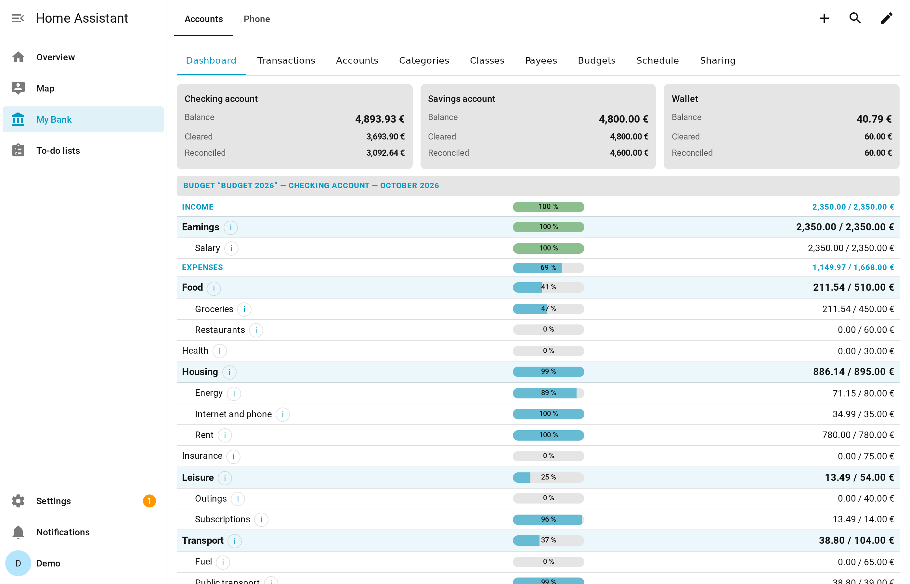
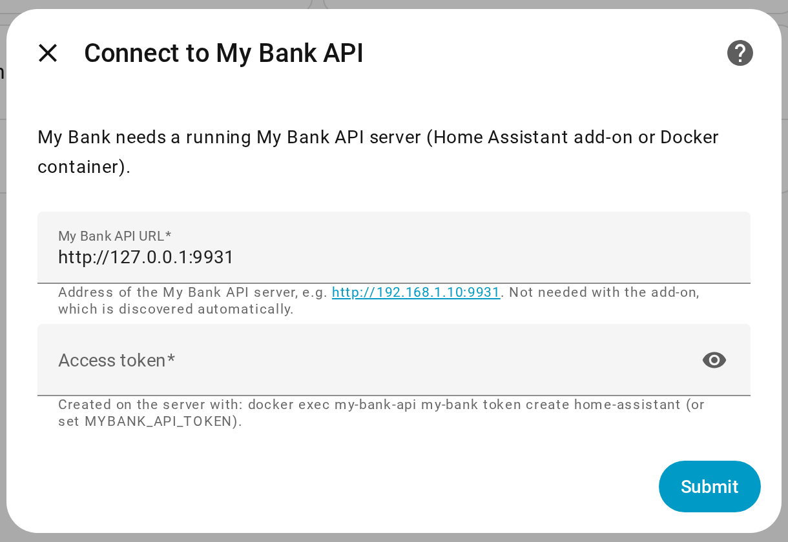
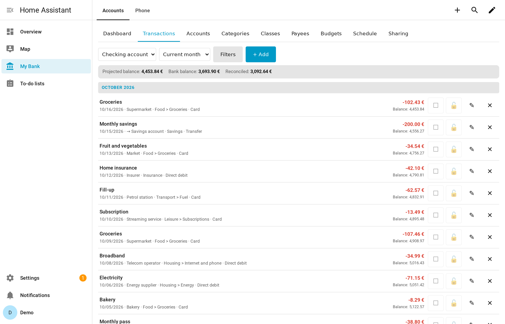
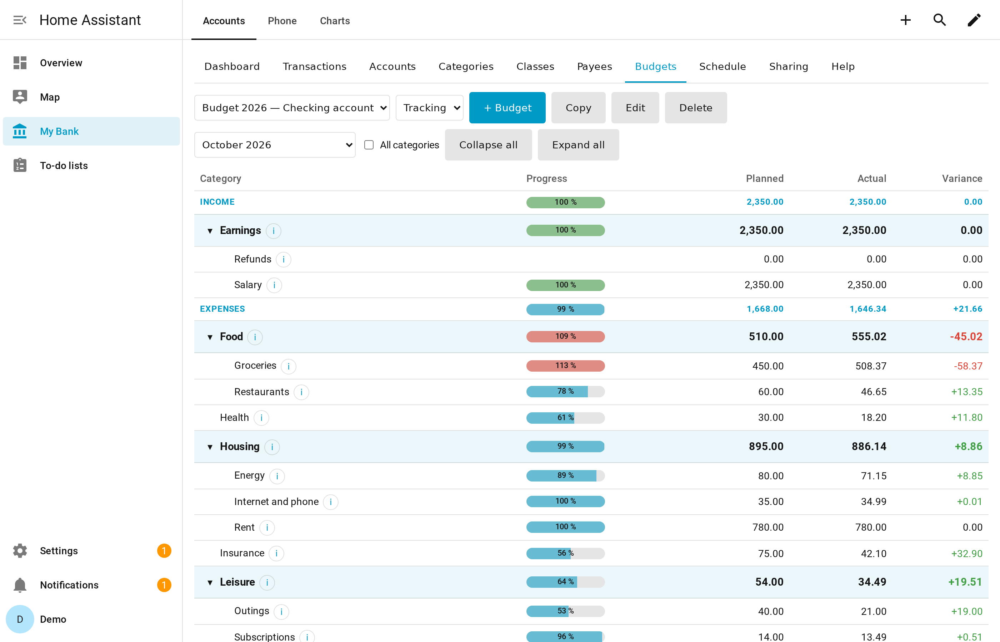
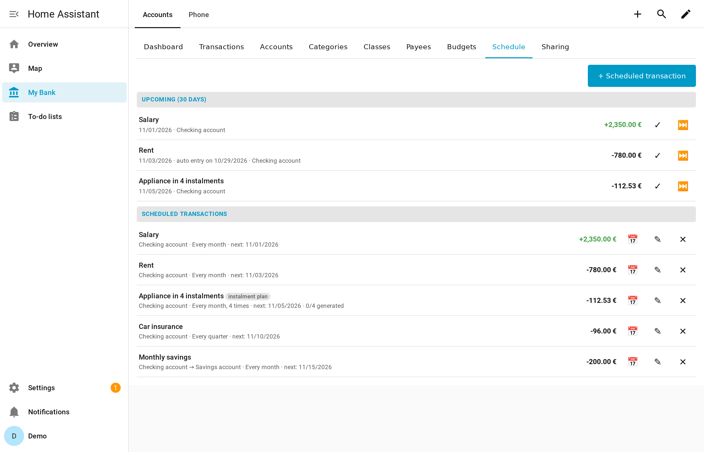
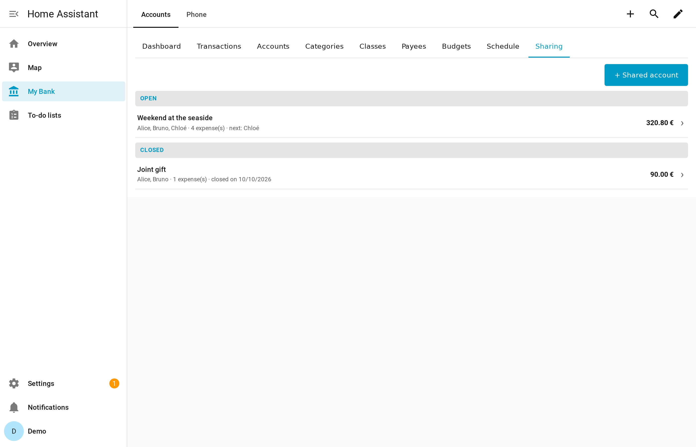
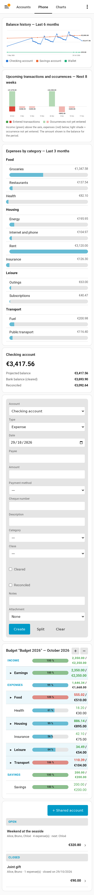

# My Bank for Home Assistant

🇫🇷 [Lire en français](https://github.com/Patafoin/ha-my-bank/blob/main/README.fr.md)

[](https://hacs.xyz/)
[](https://github.com/Patafoin/ha-my-bank/actions/workflows/validate.yml)
[](https://github.com/Patafoin/ha-my-bank/actions/workflows/tests.yml)

Personal bookkeeping in Home Assistant, the way desktop money managers do it: accounts with three balances, cleared and reconciled transactions, splits, transfers, hierarchical categories, scheduled transactions, budgets, and shared expenses between friends — from a dashboard card, on your phone, anywhere.



> Available in **English, French and German** (cards, services, setup, server messages), following the Home Assistant language.

## How it works

My Bank comes in two parts:

| Part | What it is | How to install |
|---|---|---|
| **My Bank API** | The server: stores your data in a local SQLite database, computes balances and budgets, generates scheduled transactions, backs itself up every night | Home Assistant **add-on** (Home Assistant OS / Supervised), or a **Docker** container |
| **My Bank** (this repository) | The integration and its Lovelace cards: sensors, services, and the user interface | **HACS** |

The integration is a thin client: every rule (balances, locking of reconciled transactions, budget computations…) lives in the server. Your data never leaves your network.

## Installation

### 1. The server

**Home Assistant OS / Supervised — add-on (recommended)**

[](https://my.home-assistant.io/redirect/supervisor_add_addon_repository/?repository_url=https%3A%2F%2Fgithub.com%2FPatafoin%2Fha-addons)

Add the repository `https://github.com/Patafoin/ha-addons`, install **My Bank API** and start it. That's all: the add-on creates an access token for Home Assistant and announces itself.

**Home Assistant Container / Core — Docker**

```yaml
# compose.yaml
services:
  my-bank-api:
    image: ghcr.io/patafoin/my-bank-api:latest
    container_name: my-bank-api
    restart: unless-stopped
    ports:
      - "9931:8000"
    volumes:
      - ./data:/data
      - ./backups:/backups
    environment:
      TZ: Europe/Paris
      MYBANK_API_TOKEN: "change-me-to-a-long-random-string"
```

```bash
docker compose up -d
```

See the [My Bank API README](https://github.com/Patafoin/my-bank-api) for all settings.

### 2. The integration

[](https://my.home-assistant.io/redirect/hacs_repository/?owner=Patafoin&repository=ha-my-bank&category=integration)

In HACS: ⋮ → **Custom repositories** → `https://github.com/Patafoin/ha-my-bank`, type **Integration**. Download **My Bank**, then restart Home Assistant.

### 3. Connect them

- **With the add-on**: Settings → Devices & services shows **My Bank** as discovered. Click **Configure** → **Submit**.
- **With Docker**: Settings → Devices & services → **Add integration** → **My Bank**, then enter the server URL (e.g. `http://192.168.1.10:9931`) and the token (`MYBANK_API_TOKEN`).



### 4. Add the card

The card is registered automatically (no resource to add). Edit a dashboard → **Add card** → **My Bank**.

## The cards

### `custom:my-bank-card` — everything, one tab per subject

| Tab (`sections` key) | Content |
|---|---|
| `dashboard` | Balances of every account, budget of the current month |
| `transactions` | Transactions of an account with running balance; filters; add, edit, split, transfer; clear (☐/☑) and reconcile (🔓/🔒) in one click |
| `accounts` | Accounts (checking, savings, card, cash…), opening balance, closing |
| `categories` / `tags` | Category tree (income / expense / savings) and a second, free classification axis |
| `payees` | Payees with default category |
| `budgets` | Monthly budget per account: planned vs actual, variance, copy from a previous budget |
| `recurrences` | Scheduled transactions (periodic or instalment plans), upcoming occurrences, automatic generation |
| `shares` | Shared expenses of a group (holidays…): who pays next, who owes whom at the end |

```yaml
type: custom:my-bank-card
sections:        # optional: omit to show every tab
  - dashboard
  - transactions
```

Give each card instance its own `sections` to build an operations-only view, a settings view, etc.

| Transactions | Budgets |
|---|---|
|  |  |

| Scheduled transactions | Shared expenses |
|---|---|
|  |  |

### Small cards for a phone dashboard



| Card | Options |
|---|---|
| `custom:my-bank-balance-card` | `account_id` — the three balances of one account |
| `custom:my-bank-entry-card` | `account_id`, `fields` — quick entry, pre-filled from the payee |
| `custom:my-bank-budget-card` | `budget_id`, `levels`, `period` (`month`, `cumul`, `all`) |
| `custom:my-bank-share-card` | — shared expenses |

All cards have a visual editor.

<br clear="right">

## Entities

- **One sensor per account**: state = total balance (including future-dated transactions); attributes `solde_pointe` (cleared), `solde_rapproche` (reconciled), `account_id`, `kind`, `iban`, `closed`. Refreshed every 5 minutes and after every change.
- **`sensor.planifications_arrivant_a_terme`**: number of scheduled transactions whose last occurrence falls within 30 days, with the list in attributes — handy for a notification automation.

## Services

Every object can be created, modified or deleted from automations and scripts: `my_bank.create_transaction`, `create_transfer`, `set_transaction_state`, `create_schedule`, `set_budget_lines`, `add_shared_expense`… (50+ services, see **Developer tools → Actions**). Read services (`list_accounts`, `search_transactions`, `get_budget_report`…) return data with `response_variable`.

```yaml
action: my_bank.create_transaction
data:
  account_id: 1
  date: "2026-10-09"
  amount: "-12.50"
  payee_name: Bakery
  category_id: 5
```

## Languages

The cards, the setup dialogs, the services and the error messages of the server follow the language of Home Assistant: English, French or German (English for any other language). On a fresh install, the default payment methods created by the server are renamed in that language.

## Updating

Update the integration with HACS and the server with the add-on store (or `docker compose pull`). If the server is older than the integration needs, Home Assistant raises a repair issue telling you so.

## Importing from MS Comptes Bancaires

The server imports the QIF and payee CSV exports of MS Comptes Bancaires — see the [My Bank API README](https://github.com/Patafoin/my-bank-api).

## Security

Keep My Bank API on your local network. Never expose it to the Internet: remote access goes through Home Assistant, which already handles authentication.

## Translations

Adding or fixing a language is welcome:

- Home Assistant texts (setup, services, repairs): `custom_components/my_bank/translations/<lang>.json`, with `strings.json` as the English source.
- Cards: the `I18N` dictionary at the end of `custom_components/my_bank/www/my-bank-card.js`, keyed by the French text of the card.
- Server messages: `src/my_bank_api/i18n_messages.py` in [my-bank-api](https://github.com/Patafoin/my-bank-api).

Tests check that every text has an English and a German version, with the same `{placeholders}`.

## License

MIT
